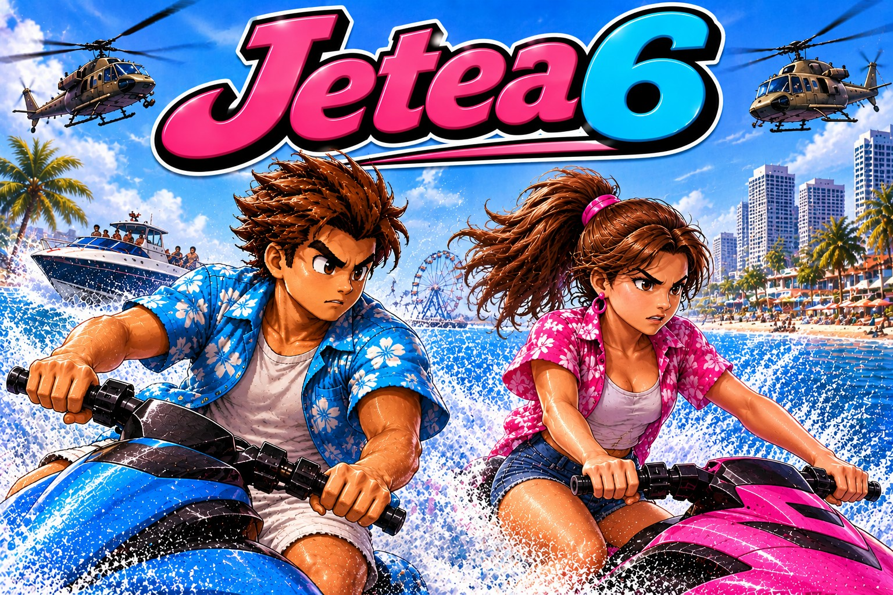
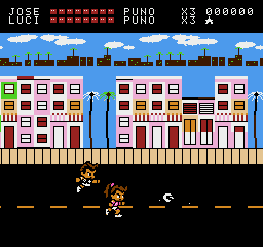
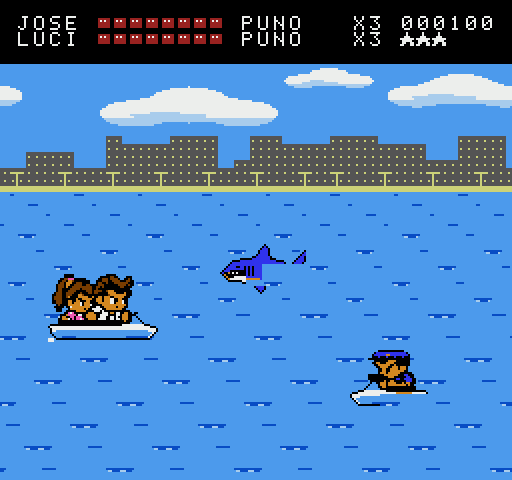
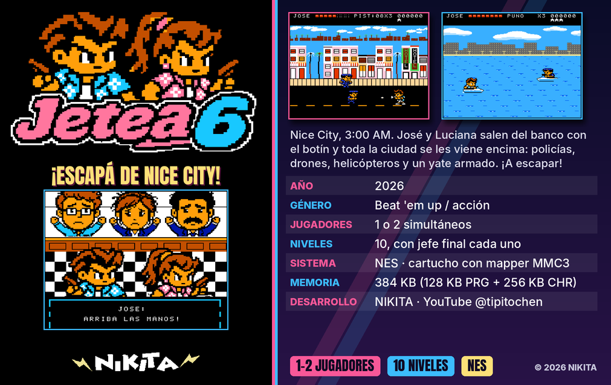

<p align="center">
  
</p>

# JETEA 6

**Un beat 'em up original para NES**, hecho desde cero en ensamblador 6502: robo, persecución y tiros por las calles, el cielo y el mar de **Nice City**.

<p align="center">
  <a href="https://github.com/tipitochen/jetea6/releases/latest"></a>
  <a href="https://www.youtube.com/@tipitochen"></a>
</p>

🎮 **ROM lista para jugar:** [`JETEA6.nes`](JETEA6.nes) (mapper MMC3, 128 KB de PRG + 256 KB de CHR)

| | |
|:---:|:---:|
| <br><em>Al encender, el logo de NIKITA</em> | <br><em>La pantalla de título</em> |

## Fotos

| | |
|:---:|:---:|
| <br>Nivel 1: Playa Nice, a dos jugadores | <br>Nivel 2: Cielos de Nice, en helicóptero |
| <br>Nivel 6: la salida desde el muelle | <br>Nivel 6: tiburones en la bahía |
| <br>Jefe del nivel 6: el yate del capo | <br>El final... rumbo a Paysandú |

## 📦 El cartucho

| Adelante | Atrás |
|:---:|:---:|
|  |  |

Los archivos para imprimir están en [`extras/tarjeta/`](extras/tarjeta/). La etiqueta trasera tiene el tamaño de una tarjeta de crédito.

## 🕹️ Extras

En [`extras/`](extras/) están las **versiones anteriores** del juego (GTA6 v1, v1.5 y v2), el **hack de Contra GTA6** donde empezó la idea y las **tarjetas del cartucho**.

## Estructura del repositorio

```
JETEA6.nes   la ROM, lista para jugar
README.md    esto
docs/        fotos, portada y etiqueta para el README
extras/      versiones anteriores, hack de Contra y tarjetas para imprimir
src/         todo el código fuente y los gráficos de referencia
```

## La historia

Nice City, 3:00 AM. Suena la alarma del banco. **José Dualcore** y **Luciana Carreteras** salen con el botín y toda la ciudad se les viene encima: patrulleros, drones, helicópteros, el ejército... Diez niveles para escapar.

Al final de los créditos ya se sabe adónde van después: **Paysandú, Uruguay**.

## Características

- **2 personajes jugables**: José y Luciana, cada uno con sus sprites y su final.
- **2 jugadores simultáneos**.
- **10 niveles** con jefe al final de cada uno.
- **Vehículos**: autos y motos para subirse en plena calle (A+B). Se dispara con el arma que tengas y las balas se gastan.
- **Arsenal**: menú de armas (SELECT) con el personaje girando como una figura de acción.
- **Nivel 2, CIELOS DE NICE**: shoot 'em up en helicóptero contra drones policiales y helicópteros. El jefe es un helicóptero militar.
- **Nivel 6, BAHÍA DE NICE**: persecución en moto de agua contra policías en sus motos y tiburones que saltan del agua. El jefe es un yate con tiradores en la cubierta.
- **Cinemáticas**: el robo al banco, la subida al helicóptero en la azotea, la salida desde el muelle y el final.
- **Código Konami** (↑ ↑ ↓ ↓ ← → ← → B A) en la pantalla de título para elegir nivel, incluido el final.
- Música y efectos propios.

## Niveles

| # | Nivel | Jefe |
|---|-------|------|
| 1 | Playa Nice | Patrullero blindado |
| 2 | Cielos de Nice *(helicóptero)* | Helicóptero militar |
| 3 | Puerto del Sol | Camión SWAT |
| 4 | Los Cayos | Helicóptero |
| 5 | Autopista 95 | Robot antimotines |
| 6 | Bahía de Nice *(motos de agua)* | Yate del capo |
| 7 | Distrito Art Deco | Tanque |
| 8 | Aeropuerto | Avión de ataque |
| 9 | Centro Nocturno | Mecha militar |
| 10 | La Mansión | Súper tanque |

## Controles

| Botón | Acción |
|-------|--------|
| Cruz | Moverse (arriba/abajo cambia la profundidad) |
| B | Golpe / disparo |
| A | Salto |
| A + B | Subir o bajar del vehículo |
| ← ← / → → | Correr |
| SELECT | Arsenal (elegir arma) |
| START | Pausa |

En el helicóptero y en la moto de agua, con 2 jugadores el jugador 1 maneja y el jugador 2 dispara y apunta.

## Compilar

Hace falta Python 3 con `Pillow` y `numpy`. No hacen falta herramientas externas: el ensamblador está incluido.

```bash
cd src
python3 build4.py          # genera los gráficos y arma src/JETEA6.nes
python3 build4.py --nogen  # solo ensambla (más rápido, si no cambiaste gráficos)
```

Si un salto relativo queda fuera de rango: `python3 fixbr.py game4.asm`.

## Cómo está organizado `src/`

| Archivo | Qué hace |
|---------|----------|
| `asm.py` | Ensamblador 6502 propio |
| `emu.py` | Emulador NES mínimo para las pruebas automáticas |
| `build4.py` | Compila todo (generadores + ensamblado) |
| `gen4.py` | Genera el CHR (gráficos) y las tablas de sprites |
| `game4.asm` | Archivo principal: RAM, bancos y vectores |
| `core4.asm`, `play4.asm`, `boss4.asm`, `menus4.asm` | Banco fijo: motor, juego, jefes, menús |
| `heli.asm` + `heli_gen.py` | Nivel 2, el del helicóptero (banco 8) |
| `agua.asm` + `agua_gen.py` | Nivel 6, el de las motos de agua (banco 9; los mapas grandes en el banco 10) |
| `bank2code.asm` | Pantalla de título y código Konami |
| `bank7.asm` + `arsenal_gen.py` | Logo, pausa y arsenal |
| `story_gen.py`, `bank3-6.asm` | Escenas de la historia |
| `music4.asm` | Música |
| `t*.py` | Pruebas automáticas que corren en el emulador |
| `ref/`, `story/`, `title/` | Imágenes de referencia para generar los gráficos |
| `game.asm`, `game2.asm`, `game3.asm`, `*3.asm` | Versiones anteriores del juego (historial) |

Mapa de PRG (bancos de 8 KB): 0 sprites · 1 música y niveles · 2 título · 3-6 historia · 7 logo, pausa y arsenal · 8 helicóptero · 9-10 motos de agua · banco fijo en `$C000-$FFFF`.

<details>
<summary>Todas las capturas juntas</summary>


</details>

---

## 🎬 Mi canal de YouTube

Más proyectos de NES, cartuchos y cosas retro en mi canal:

<p align="center">
  <a href="https://www.youtube.com/@tipitochen"></a>
</p>

<p align="center"><a href="https://www.youtube.com/@tipitochen">youtube.com/@tipitochen</a></p>

---

*Proyecto personal. Probado en el emulador incluido; puede comportarse distinto en hardware real.*
