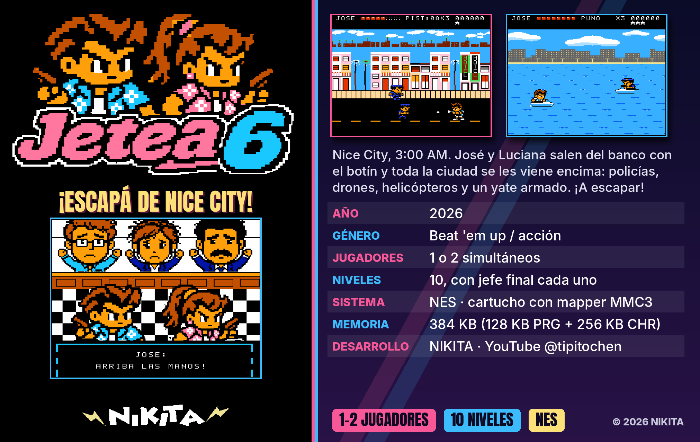
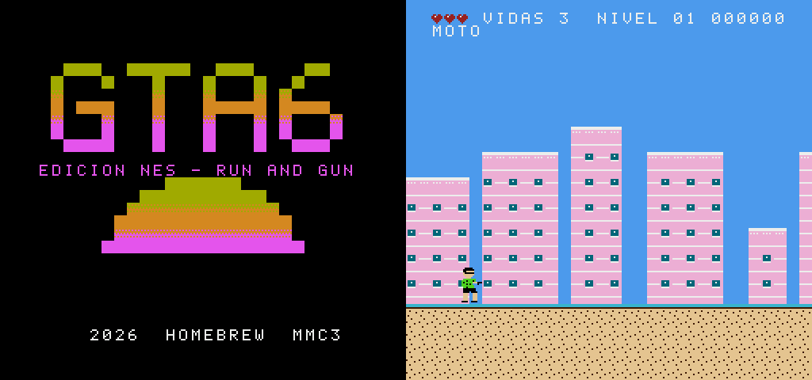
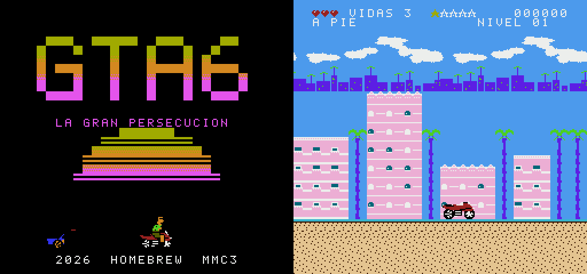
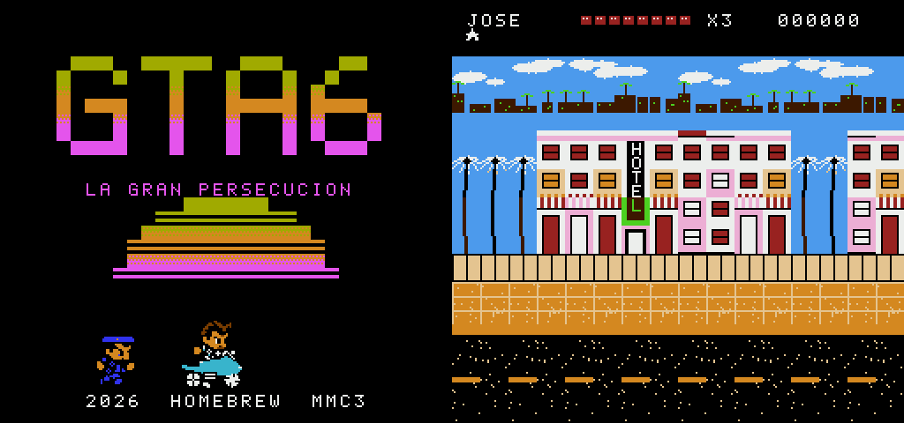

# 🕹️ Extras

Todo lo que no es el juego final, pero cuenta su historia: las versiones anteriores, el hack de Contra donde empezó la idea y las tarjetas del cartucho.

[← Volver al README principal](../README.md)

---

## 📦 Tarjetas del cartucho

| Adelante | Atrás |
|:---:|:---:|
|  |  |

Archivos para imprimir:
- [`JETEA6_portada.png`](tarjeta/JETEA6_portada.png): la portada
- [`JETEA6_etiqueta_trasera.png`](tarjeta/JETEA6_etiqueta_trasera.png): la etiqueta trasera, 85,6 × 54 mm (tamaño tarjeta de crédito) a 600 dpi
- [`JETEA6_etiqueta_trasera.pdf`](tarjeta/JETEA6_etiqueta_trasera.pdf): la misma etiqueta en PDF, en tamaño real. Imprimila al 100 %.

---

## 🗂️ Versiones anteriores

Así fue cambiando el juego hasta llegar a **JETEA 6**. Todas son ROMs de NES con mapper MMC3 y se abren en cualquier emulador.

### GTA6 v1: *Edición NES, run and gun*

La primera versión: un run and gun con motos, todavía con el nombre "GTA6".
📥 [`GTA6_v1.nes`](versiones/GTA6_v1.nes), 48 KB

### GTA6 v1.5: *La gran persecución*

Nueva pantalla de título, ciudad con palmeras y motos estacionadas para subirse.
📥 [`GTA6_v1.5.nes`](versiones/GTA6_v1.5.nes), 128 KB

### GTA6 v2: *el salto al beat 'em up*

El cambio a beat 'em up estilo Tortugas Ninja, con sprites grandes y José en la calle. Es la base de lo que después fue JETEA 6.
📥 [`GTA6_v2.nes`](versiones/GTA6_v2.nes), 192 KB

### JETEA 6 v1.0: la versión final
La ROM está en la raíz del repositorio: [`JETEA6.nes`](../JETEA6.nes).

---

## 🔫 Contra GTA6 (hack)

Antes del juego propio hubo un **hack de Contra** con temática GTA 6: escenarios de Vice City, el jugador 1 hombre y el jugador 2 mujer.

📥 [`contra_gta6_v8_mmc3.ips`](versiones/contra_gta6_v8_mmc3.ips): parche IPS, versión 8

Es un **parche**, no una ROM. Para jugarlo:
1. Conseguí tu propia ROM de **Contra (USA)** para NES.
2. Aplicale el parche con [Floating IPS](https://www.romhacking.net/utilities/1040/) o Lunar IPS.
3. Abrí la ROM parcheada en el emulador.
